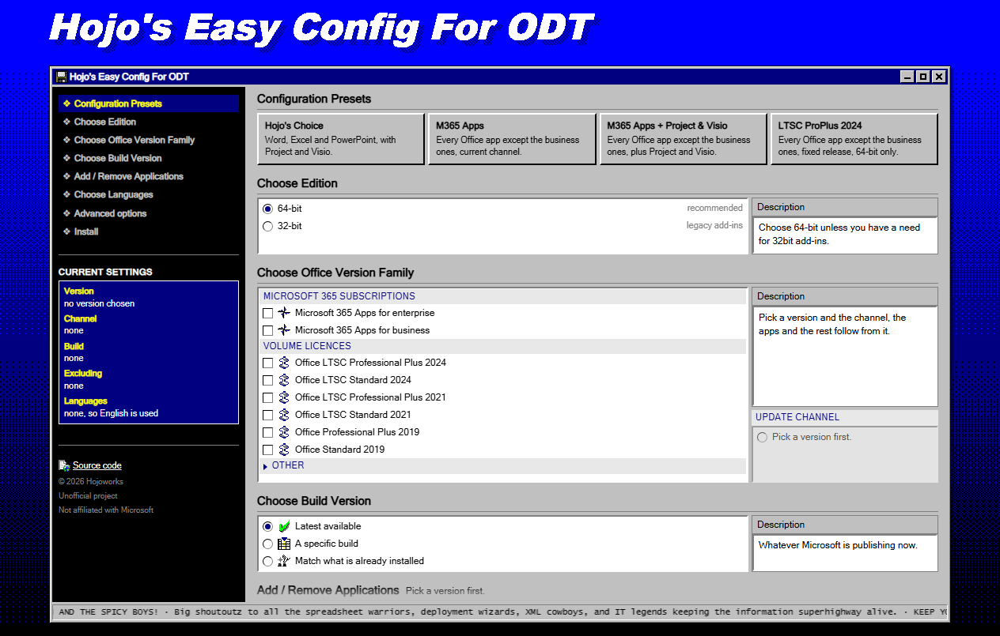

# Hojoworks ODT

A Windows 3.1-style setup screen that writes the Office Deployment Tool's `configuration.xml` for you. Pick your
product, apps, version and languages, then take the result three ways: the XML itself, the ODT commands to run
yourself, or one line of PowerShell that does the lot.

This is an unofficial community tool. It is not affiliated with, or endorsed by, Microsoft.

**<https://hojoworks.github.io/odt-ps/>**



## The web page

Nothing is ticked to start with, and nothing is stored. A refresh clears the choices, and the browser is asked to
warn you first. Untick the version you picked and the page goes back to its untouched state.

Four presets fill the whole form in: **Hojo's Choice**, **M365 Apps**, **M365 Apps + Project & Visio** and
**LTSC ProPlus 2024**. The first installs Word, Excel and PowerPoint with Project and Visio. The other three install
everything except the business apps: Teams, both OneDrives, Skype and new Outlook. Everything after that is optional.

No build number, download size or release date is written into the page. Microsoft publishes new ones every month, so
a figure typed into a web page is stale within weeks. Products, channels, languages and apps live in
`site/odt-data.js`, where they are easy to correct.

## Installing

The Install section offers three things.

1. **Automatic Install**, one line that runs the installer with exactly your settings:

   ```powershell
   $env:ODT_ARGS='-Product O365ProPlusRetail -Languages en-us -ShowWindow -Download -Install -Silent'; irm https://hojoworks.github.io/odt-ps/get.ps1 | iex
   ```

2. **Manual Install**, a disclosure holding `configuration.xml`, to save or copy, and the Office Deployment Tool
   commands to run yourself.

3. A link to Microsoft's Office Deployment Tool download, for the manual route.

The installer fetches the Office Deployment Tool from Microsoft, writes `configuration.xml` from your settings, then
runs `setup.exe /download` and/or `/configure`. It reports the exit code and the log path, and the ODT writes its
logs to `%temp%`. A successful install then removes the folder it filled, because several GB of files nobody needs
twice is only space. Tick **Keep the downloaded files** under Advanced options, or pass `-KeepFiles`, to keep them.

It also has a Remove Office mode, which uninstalls every Click-to-Run product it finds.

### The switches the page writes for you

These are the installer's parameters. The page fills them in, and they are the same words if you would rather type
the line yourself.

| Parameter | Meaning |
| --------- | ------- |
| `-Product` | Product IDs, comma separated, for example `O365ProPlusRetail` |
| `-Channel` | Update channel, for example `Current` or `MonthlyEnterprise`. Chosen for you when omitted |
| `-Arch` | `64` or `32`. LTSC 2024 is 64-bit only |
| `-Languages` | Culture codes, for example `en-us,de-de` |
| `-Exclude` | `ExcludeApp` IDs, for example `Publisher,Teams,Groove` |
| `-Version` | A pinned build such as `16.0.17928.20156`, or `MatchInstalled` |
| `-Download` / `-Install` | Which steps to run. Both run when neither is given |
| `-RemoveAll` | Uninstall every Click-to-Run product on the machine |
| `-ShowWindow` | Show Microsoft's setup window instead of installing silently |
| `-Silent` | Never prompt |
| `-KeepFiles` | Keep the downloaded files instead of removing them when the install is done |

The exit code is `0` on success, the ODT's own code when setup fails, and `1` on a bad argument. Every setting is a
parameter and nothing prompts, so the line drops straight into RMM and task sequences.

## What it does not do

No activation, no keys, no KMS emulation and no patching. No bundled binaries, since everything comes from Microsoft
URLs at run time. No telemetry. Deploying Office is all this does, and activating it needs a licence you own.

## If a copy button is blocked

uBlock Origin ships a rule that stops pages writing shell commands to the clipboard, because that is how ClickFix
attacks work, and the one-line install matches it. Copying still works. uBlock shows the command in its own alert, and
the page's Copy buttons notice a hooked clipboard and tell you to press Ctrl+C instead. Nothing here is obfuscated to
get around a filter, because that is what a real ClickFix page does. Details are in
[docs/uassets-allowlist.md](docs/uassets-allowlist.md).

## Requirements

Windows 10 or 11 with the built-in Windows PowerShell 5.1, administrator rights for installing, which the one-liner
asks for through UAC, and a few GB of free disk space for download mode. Microsoft documents the
[exit codes](https://learn.microsoft.com/en-us/microsoft-365-apps/error-codes).

## Licence

Apache 2.0. See [LICENSE](LICENSE) for the terms and [NOTICE](NOTICE) for the attribution that has to travel with
them.

That one licence covers the whole repository: the installer, the page, and the pixel-art icons drawn for it. The
OpenOffice.org 1.1 pictograms and toolbar buttons were already Apache 2.0 before they arrived, so they need no
separate terms. [icons/ooo11/README.md](icons/ooo11/README.md) records which files came from where and what was
changed, and [docs/credits.md](docs/credits.md) covers the rest.

Unofficial community tool. Not affiliated with, or endorsed by, Microsoft.
